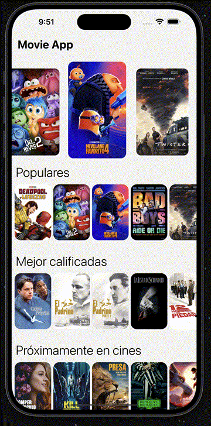
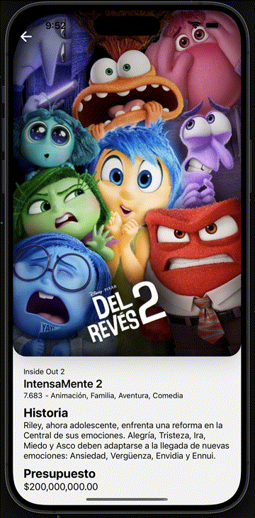
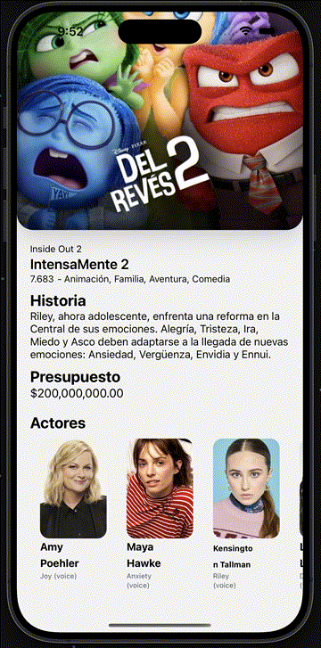

# Movies App

App móvil de películas construida con **Expo SDK 58 / React Native 0.88** que consume la API de
[TMDB (The Movie Database)](https://www.themoviedb.org/). Muestra un carrusel principal con los
posters destacados, listas horizontales de películas por categoría con scroll infinito y una pantalla
de detalle con sinopsis, presupuesto, puntuación y reparto.

El estilo se resuelve con [**Uniwind**](https://uniwind.dev) (Tailwind CSS v4 para React Native) y
los datos con **TanStack Query** sobre **Axios**.

## Capturas

<table>
  <tr>
    <td align="center"><br /><sub>Pantalla principal</sub></td>
    <td align="center"><br /><sub>Detalle de película</sub></td>
    <td align="center"><br /><sub>Detalle con actores</sub></td>
  </tr>
</table>

## Características

- Pantalla principal con carrusel de "now playing" con animación de paralaje.
- Listas horizontales por categoría: populares, próximas a estrenarse y mejor valoradas, con scroll
  infinito paginado (la API de TMDB topa en 500 páginas).
- Pantalla de detalle de película: póster, sinopsis, presupuesto, puntuación con estrellas y reparto.
- Arquitectura por capas (core / infrastructure / presentation) para separar lógica, datos y UI.
- Manejo de errores tipado con `tryCatch` y caché de 24 h por categoría.
- Diseño *safe area* aware: el contenido nunca queda bajo la barra de estado o de navegación.

## Requisitos

- [Node.js](https://nodejs.org) 20 o superior.
- [Bun](https://bun.sh) (el proyecto usa `bun.lock`).
- Una API key gratuita de TMDB: <https://www.themoviedb.org/settings/api>.

## Puesta en marcha

1. Instala las dependencias:

   ```bash
   bun install
   ```

2. Configura las variables de entorno. Copia el archivo de ejemplo:

   ```bash
   cp .env.template .env
   ```

   ```dotenv
   EXPO_PUBLIC_MOVIE_DB_KEY=tu_api_key
   EXPO_PUBLIC_MOVIE_DB_URL=https://api.themoviedb.org/3/movie
   ```

   Las variables `EXPO_PUBLIC_*` se incrustan en el bundle, por lo que la key queda expuesta en el
   binario. Es aceptable para una app de demostración, pero en producción conviene pasar por un
   proxy propio.

3. Arranca el servidor de desarrollo:

   ```bash
   bunx expo start
   ```

Funciona en **Expo Go** (Uniwind es JS puro, no requiere development build).

## Scripts

```bash
bunx expo start        # servidor de desarrollo
bunx expo start --ios  # abre en iOS
bunx expo start --android
bunx expo start --web
bunx expo lint         # ESLint
bunx tsc --noEmit      # typecheck
```

## Estructura

```
06-movies-app/
  app.json                    # Configuración de Expo (plugins, iconos, experiments)
  metro.config.js             # Metro con el wrapper de Uniwind
  tsconfig.json               # TypeScript strict + alias @/ -> src/
  assets/
    images/                   # iconos de la app (icon, splash, favicon, adaptive icon)
    expo.icon/                # icono vectorial de iOS
  img/                        # capturas del README
  scripts/
    reset-project.js          # script de reset de Expo
  src/
    app/                      # Rutas de Expo Router (cada archivo es una pantalla)
      _layout.tsx             # GestureHandlerRootView + Stack + QueryClientProvider + import del CSS
      index.tsx               # redirección a /home
      home/index.tsx          # pantalla principal (carrusel + listas horizontales)
      movie/[id].tsx          # detalle de película (imagen, sinopsis, presupuesto, reparto)
    core/                     # Lógica de negocio y acceso a datos
      actions/
        index.ts              # barrel de acciones
        movie/
          get-movie-by-id.action.ts  # detalle de una película (incluye credits)
        movies/
          now-playing.action.ts     # listados paginados: now playing, popular, upcoming, top rate
          popular.action.ts
          upcoming.action.ts
          topRate.action.ts
      api/
        movie-api.ts          # instancia de Axios con la base URL, la api key y el idioma
      constants/
        index.ts
        movie.constants.ts    # TMDB_MAX_PAGE (límite de paginación de la API)
    infrastructure/           # Contratos externos y mappers
      index.ts                # barrel (interfaces + mappers)
      interfaces/
        index.ts
        movie.interface.ts    # IMovie, IMoviePage, ICompleteMovie, ICastMember (dominio)
        moviedb-reponse.ts    # MovieDBMoviesResponse, Result (API)
        moviedb-movie.response.ts    # MovieDbMovieResponse (detalle)
        moviedb-credits.response.ts # MovieDbCreditsResponse (reparto y equipo)
      mappers/
        movie.mapper.ts       # MovieDB -> IMovie / ICompleteMovie
    presentation/             # UI: componentes y hooks
      index.ts                # barrel de la capa
      components/
        SafeAreaScreen.tsx    # contenedor con los insets del sistema
        movie/                # MovieCardImage, MovieCardDescription, MovieCastList, RatingStars
        movies/               # MainSlideShow, MovieHorizontalList, MoviePoster
      hooks/
        useMovies.tsx         # queries de listados (useQuery + useInfiniteQuery)
        useMovieById.ts       # query del detalle de película
        useMainSlideShow.ts   # carrusel con paralaje
        useSafeAreaLayout.ts  # insets y medidas útiles
    utils/
      index.ts                # barrel
      format.ts               # formatRating, formatBudget, ratingToStars
      try-catch.ts            # helper de manejo de errores tipado
    global.css                # @import 'tailwindcss' + @import 'uniwind' + @theme
    uniwind-types.d.ts        # generado por uniwind (no editar)
```

El alias `@/` apunta a `src/` (configurado en `tsconfig.json`).

## Arquitectura

El proyecto sigue una separación en tres capas, siguiendo el flujo de dependencias
`presentation -> core -> infrastructure`:

- **core**: acciones que orquestan la petición y transforman la respuesta. Las acciones de listado
  devuelven `IMoviePage` (página, total de páginas y total de resultados) y `getMovieByIdAction`
  devuelve `ICompleteMovie`; todas lanzan un error descriptivo si la llamada falla.
- **infrastructure**: define la forma de los datos que devuelve TMDB (`Result`,
  `MovieDBMoviesResponse`) y el `MovieMapper` que los convierte al modelo de dominio `IMovie`
  (fechas reales, URLs absolutas de posters, etc.). Así la UI nunca depende del contrato de la API.
- **presentation**: componentes y hooks. `useMovies` expone una query por categoría (el carrusel usa
  `useQuery` y las listas `useInfiniteQuery`) con `staleTime` de 24 horas, así que los datos cacheados
  se muestran de inmediato. `useMovieById` carga el detalle con su reparto.

## Configuración clave

**Metro** — Uniwind debe ser el wrapper más externo:

```js
const { getDefaultConfig } = require('expo/metro-config');
const { withUniwindConfig } = require('uniwind/metro');

const config = getDefaultConfig(__dirname);

module.exports = withUniwindConfig(config, {
  cssEntryFile: './src/global.css',
  dtsFile: './src/uniwind-types.d.ts',
});
```

**Tema CSS** — los tokens se definen en `src/global.css` (Tailwind v4, tema CSS-first):

```css
@import 'tailwindcss';
@import 'uniwind';

@theme {
  --color-brand-50: #eef2ff;
  --color-brand-100: #e0e7ff;
  --color-brand-500: #6366f1;
  --color-brand-600: #4f46e5;
  --color-brand-700: #4338ca;

  --radius-card: 1.25rem;
}
```

El CSS se importa **una sola vez** en el layout raíz (`src/app/_layout.tsx`).

## Notas

- **Safe area**: `useSafeAreaLayout` calcula los insets del sistema y el ancho/alto útil. En
  horizontal la barra de navegación pasa a un lateral, por eso `SafeAreaScreen` aplica los cuatro
  insets. El `Stack` de Expo Router ya monta un `SafeAreaProvider`; si renderizas contenido fuera
  de él, envuélvelo con `SafeAreaProvider` explícitamente.
- **Clases dinámicas**: no concatenes classNames (`text-${color}` no compila). Escribe la clase
  completa o usa un mapa de variantes.
- **Uniwind no deduplica** classNames; si necesitas `cn()`, usa `tailwind-merge`.
- `src/uniwind-types.d.ts` se regenera al arrancar Metro.
- `expo-router` con `typedRoutes` y React Compiler están activados en `app.json`.
- **Paginación**: TMDB limita las páginas a 500 por endpoint, así que las acciones recortan
  `page` y `totalPages` con `TMDB_MAX_PAGE` (`src/core/constants/movie.constants.ts`).
- **Barrels**: cada capa expone un `index.ts` (`src/core/actions`, `src/infrastructure`,
  `src/presentation`, `src/utils`) para imports limpios desde fuera de la capa.

## Curso

Este proyecto es una de las secciones del curso
[**React Native Expo: Aplicaciones nativas para IOS y Android**](https://www.udemy.com/course/react-native-expo/)
de **Fernando Herrera** y el equipo de
[**DevTalles**](https://www.udemy.com/user/soporte-cursos-2/), donde se explica paso a paso la
construcción de esta app de películas: peticiones HTTP con Axios, mapeo de respuestas a modelos
propios, TanStack Query con caché e infinite scroll, carousel, listas horizontales, navegación con
Expo Router, pantalla de detalle y estilos con Tailwind/Uniwind.

- Curso completo: <https://www.udemy.com/course/react-native-expo/>

El código de este repositorio corresponde a la sección **MoviesApp** del curso.

## Desarrollo asistido por IA

Este proyecto se desarrolló con el apoyo del agente de programación **Pi**
(<https://pi.dev/>), usando el modelo **MiniMax M3.1 Flash** (`MiniMax-M3.1-Flash`) para las
tareas de análisis, refactorización y documentación.
